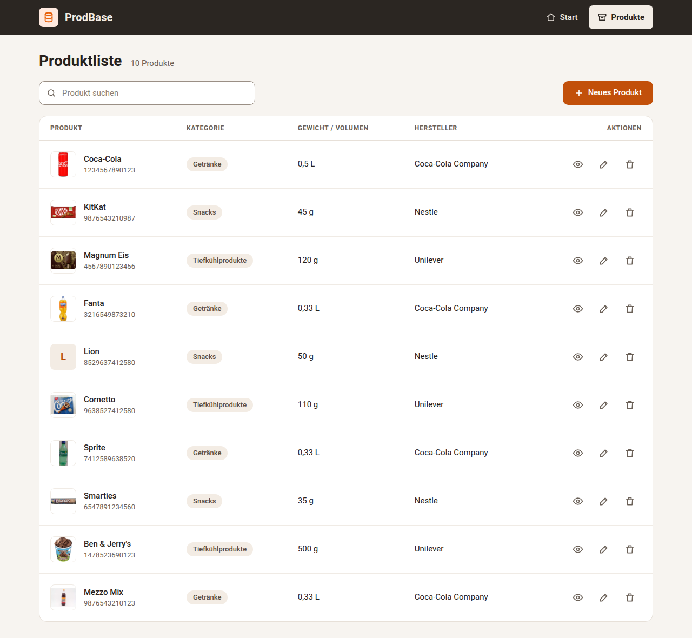
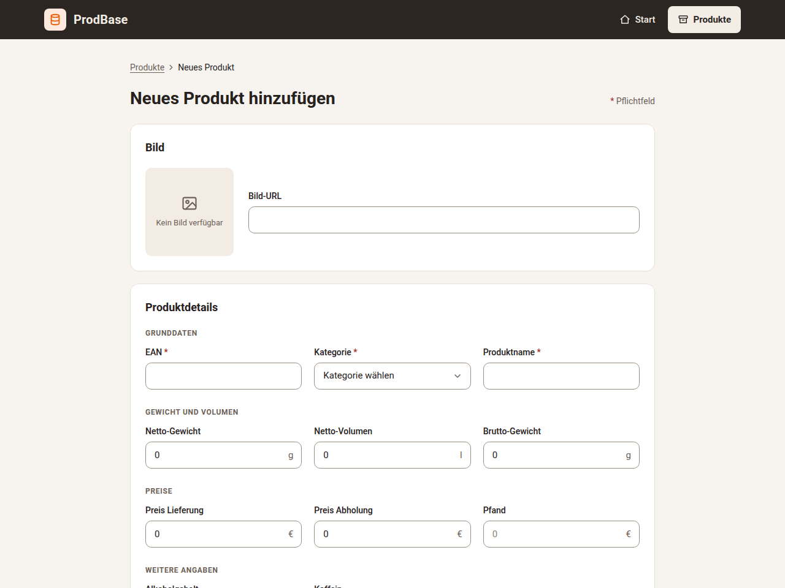
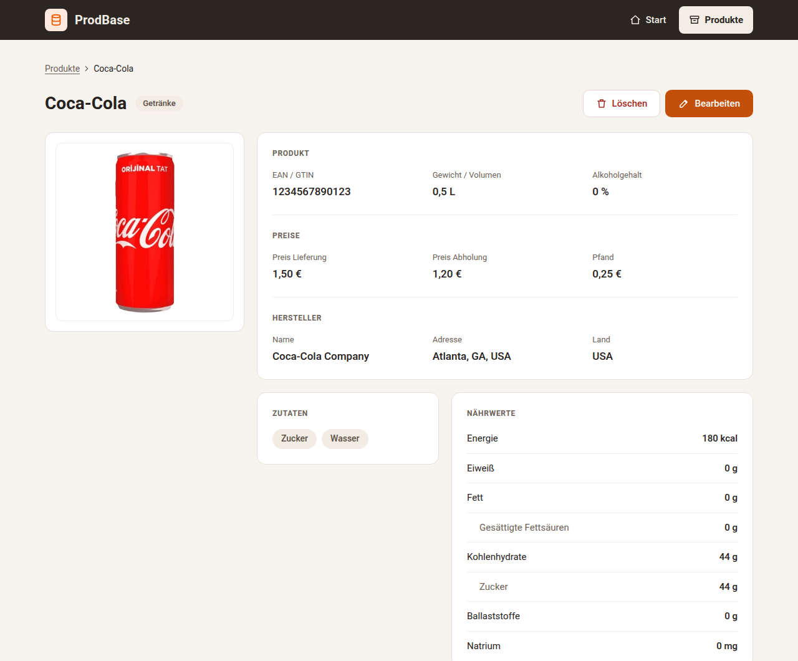
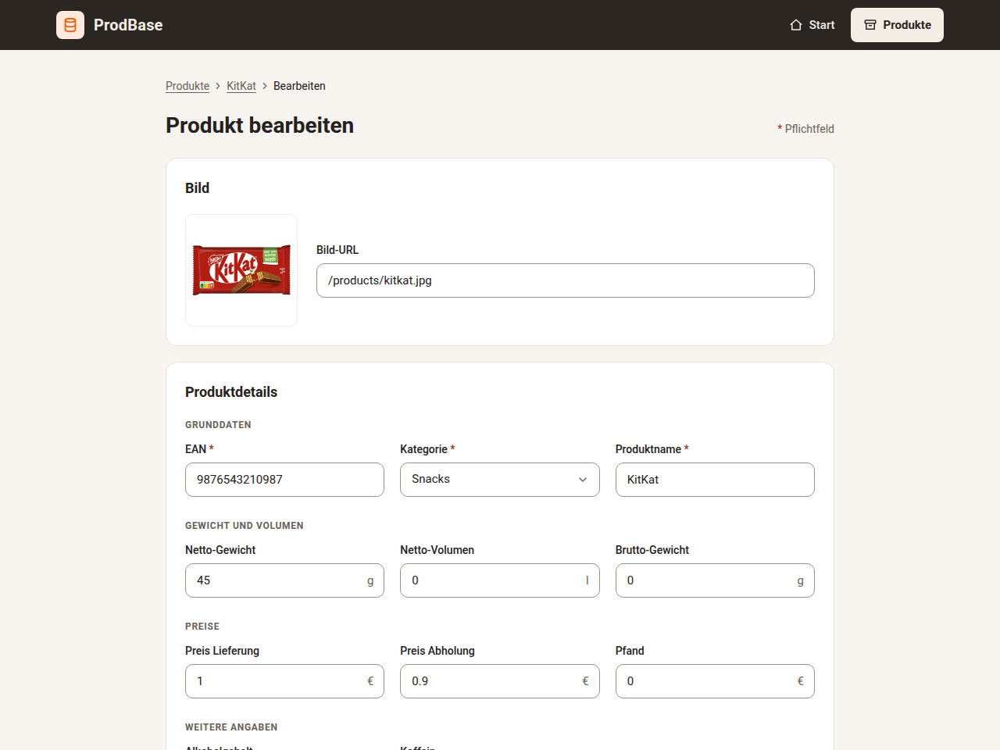

# Produktmanager

A full-stack web application for managing grocery product data: products,
categories, manufacturers, ingredients and nutrition facts, backed by a
normalized PostgreSQL schema.

**Stack:** Angular 19 · Angular Material · Node.js · Express · PostgreSQL



## Features

- **Create, view, edit and delete products**, each with its EAN/GTIN code,
  category, manufacturer, ingredient list and nutrition facts.
- **Search** across the product list.
- **Detail view** per product.
- **Seed data on startup:** the backend fills an empty database with sample
  products, so the app is usable right after the first run.
- **Confirmation dialogs** before destructive actions.

## Data model

The database is normalized instead of storing each product as one wide row:

| Table | Holds |
| --- | --- |
| `products` | One row per product, with its EAN/GTIN code |
| `categories` | Product categories (beverages, snacks, frozen food…) |
| `manufacturers` | Name, address and country |
| `ingredients` | Each ingredient once |
| `product_ingredients` | Many-to-many link between products and ingredients |
| `nutrition_info` | Nutrition facts per product |

Products share manufacturers and ingredients, so updating a manufacturer's
address changes it everywhere at once.

## Project structure

```
frontend/   Angular app (components, services, environments)
backend/    Express REST API and PostgreSQL connection
```

The two parts started as separate repositories and were merged here with their
full commit history.

## REST API

| Method | Endpoint | Description |
| --- | --- | --- |
| `GET` | `/api/products` | List all products |
| `GET` | `/api/products/:id` | Get one product with its details |
| `GET` | `/api/products/categories` | List categories |
| `POST` | `/api/products` | Create a product |
| `PUT` | `/api/products/:id` | Update a product |
| `DELETE` | `/api/products/:id` | Delete a product |

## Running locally

**Requirements:** Node.js 18.19 or later, npm, and a PostgreSQL database.

### Backend

```bash
cd backend
npm install
cp .env.example .env   # then fill in your database credentials
npm run dev            # http://localhost:5000
```

The database connection uses SSL, as required by the hosted database it was
deployed with. For a local PostgreSQL without SSL, remove the `ssl` option in
`backend/config/db.js`.

### Frontend

```bash
cd frontend
npm install
npm start              # http://localhost:4200
```

The frontend reads the API URL from `src/environments/`: `localhost:5000` in
development, the deployed backend in production.

## Screenshots

| Add a product | Product details | Edit a product |
| --- | --- | --- |
|  |  |  |

The interface is in German.
